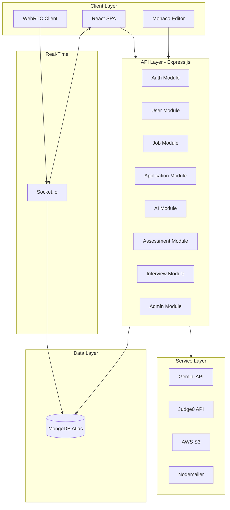
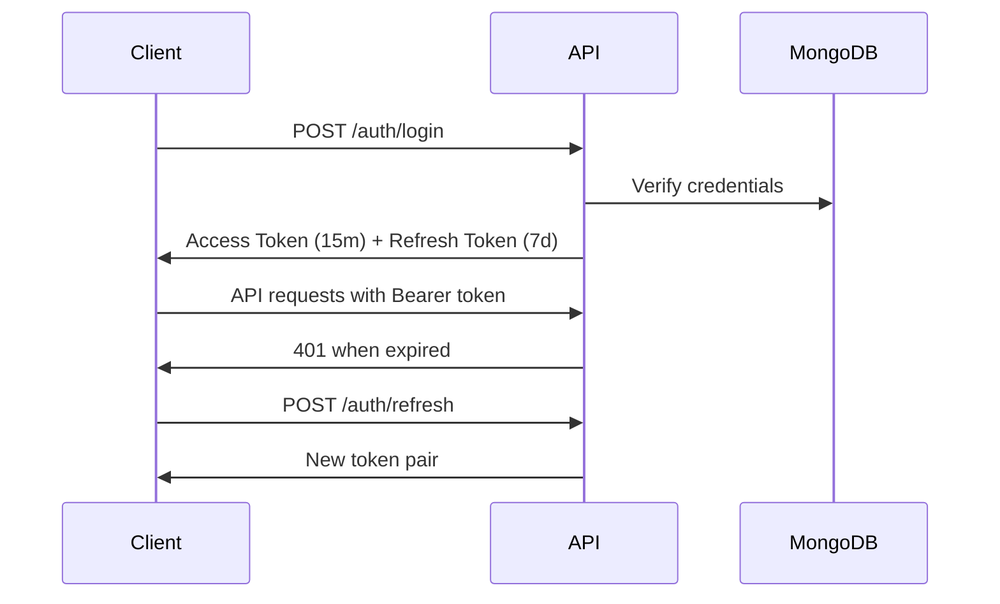
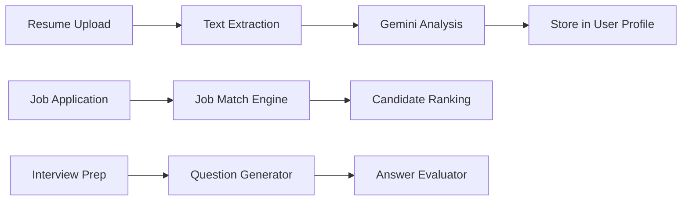

# System Architecture

## High-Level Overview

## Architecture Patterns

### Backend — MVC + Service Layer

| Layer | Responsibility |
|-------|---------------|
| Routes | HTTP endpoint definitions, middleware chaining |
| Controllers | Request/response handling, orchestration |
| Services | External integrations (AI, S3, Judge0, email) |
| Models | Data schema and business rules |
| Middlewares | Cross-cutting concerns (auth, validation, errors) |

### Frontend — Feature-Based Structure

- **Pages**: Route-level components per role/feature
- **Components**: Reusable UI primitives
- **Redux**: Auth state, notifications
- **React Query**: Server state caching
- **Services**: Axios API client with token refresh

## Authentication Flow

## AI Pipeline

## Coding Assessment Flow

1. Recruiter creates assessment with coding questions
2. Assessment assigned to candidates
3. Candidate writes code in Monaco Editor
4. Code sent to Judge0 for compilation/execution
5. Test cases evaluated automatically
6. Scores aggregated for ranking

## Real-Time Architecture

Socket.io handles:
- Chat messaging
- Online presence
- WebRTC signaling (offer/answer/ICE)
- Interview alerts
- Live notifications

## Scalability Considerations

- Stateless API servers (horizontal scaling)
- MongoDB Atlas with replica sets
- S3 for file storage (offloads server disk)
- Rate limiting per IP
- Pagination on all list endpoints
- JWT stateless auth (no server session store)
